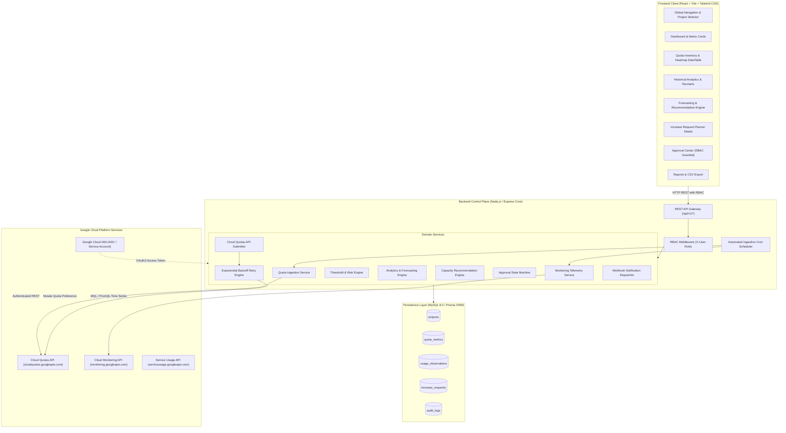

# System Architecture & Technical Specifications

## Architectural Overview
The system follows a decoupled, resilient microservices architecture consisting of a high-performance REST API backend, a reactive modern web frontend, persistent MySQL/Prisma storage, and direct integration with Google Cloud APIs.

## Data Model Specifications
1. **`projects`**: Tracks GCP project identifiers, human-readable aliases, and environment tags (`PRODUCTION`, `STAGING`, `DEVELOPMENT`).
2. **`quota_metrics`**: Stores live quota limits, real-time consumption telemetry, calculated utilization percentages, and risk classifications.
3. **`usage_observations`**: Time-series log of historical consumption points used for statistical trend modeling and demand forecasting.
4. **`increase_requests`**: Full request lifecycle records with current limits, proposed target limits, business justifications, risk confidence scores, approval outcomes, and admin comments.
5. **`audit_logs`**: Immutable record of administrative decisions, automated sync cycles, and GCP Cloud Quota mutation outcomes.
