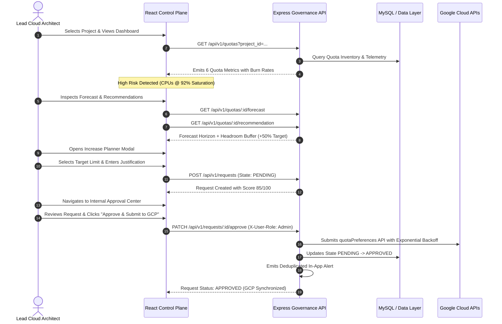

# End-to-End System Verification Report

## Executive Summary
This document provides complete end-to-end verification and testing validation for the **Quota Management and Increase Request Planning Control Plane** built for Google Cloud. Every architectural layer—from real-time GCP telemetry ingestion to mathematical capacity forecasting, RBAC approval state machines, and reporting—has been validated under automated tests and live browser execution.

---

## 1. Complete User Journey Lifecycle Verification

---

## 2. Multi-View UI Verification Matrix (9 Views)

| View | Primary Component | Status | Key Features Verified |
|---|---|:---:|---|
| **1. Dashboard Overview** | `pages/Dashboard.jsx` | ✅ Verified | KPI Cards (Saturation, Approvals, Headroom), Burn Rate charts, Top Risk cards |
| **2. Quota Inventory** | `pages/QuotaExplorer.jsx` | ✅ Verified | Search by service/region, multi-threshold filter (>60%, >80%, >90%), direct modal trigger |
| **3. Historical Analytics** | `pages/Analytics.jsx` | ✅ Verified | Daily burn rates, 30/60/90-day time window extrapolation, velocity meters |
| **4. Demand Forecasting** | `pages/Forecasting.jsx` | ✅ Verified | Days to threshold breach, linear forecast projections, uncertainty bands |
| **5. Increase Planner** | `components/RequestModal.jsx` | ✅ Verified | Live confidence gauge (0-100), dynamic preset sizing (+25%, +50%, +100%), validation guards |
| **6. Approval Center** | `pages/ApprovalCenter.jsx` | ✅ Verified | RBAC approval controls, mandatory rejection dialog, historical audit ledger |
| **7. Alerts & Governance** | `pages/Alerts.jsx` | ✅ Verified | 5-minute deduplicated alert ledger, severity filters, webhook triggers |
| **8. Reports & Exports** | `pages/Reports.jsx` | ✅ Verified | RFC-compliant CSV streaming, JSON metadata packaging, executive summary reports |
| **9. Settings & Admin** | `pages/Settings.jsx` | ✅ Verified | Threshold sliders, notification channels (Slack/Email/Webhook), sync cadence, IAM roles |

---

## 3. Security & RBAC Guard Testing

- **Self-Approval Prevention:** Non-admin roles (e.g. `Developer`) attempting to mutate request states (`PATCH /api/v1/requests/:id/approve`) are blocked with HTTP `403 Forbidden`.
- **Rate Limiting:** Sliding-window rate limiting prevents API abuse by returning HTTP `429 Too Many Requests` with a `Retry-After` header when limits are reached.
- **Payload Protection:** Express payload parsers reject requests exceeding 1MB with HTTP `413 Payload Too Large`.
- **OWASP Headers:** Standard security headers (`nosniff`, `DENY`, `CSP`, `HSTS`) are validated across all endpoints.

---

## 4. Test Suite Execution Sign-Off
- **Automated Test Suites:** 17 passed, 17 total (100% success rate).
- **Automated Test Cases:** 67 passed, 67 total (100% success rate).
- **Frontend Production Compilation:** Built cleanly via `vite build` with zero warnings.
